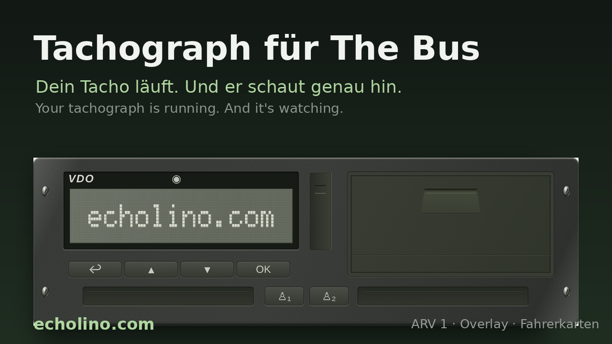
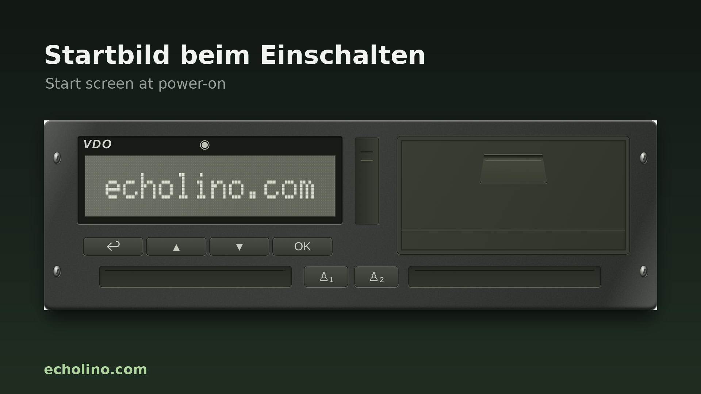
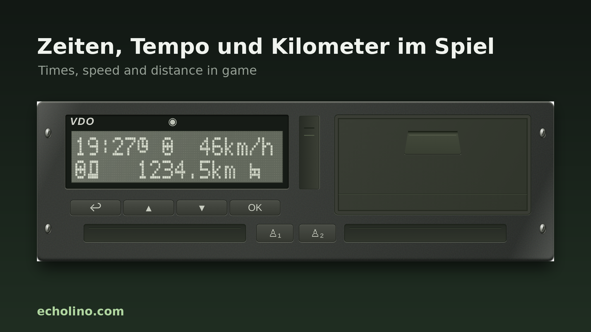

# Tachograph für The Bus · Tachograph for The Bus



**Your tachograph is running. And it's watching.**
A digital tachograph overlay for the bus simulator **The Bus**: it reads speed and vehicle data from the game's telemetry and logs driving, work, break and rest times based on the EU driving and rest time rules (561/2006) / Swiss EU-Lenk- und Ruhezeiten (561/2006) / Schweizer ARV 1.

**Dein Tacho läuft. Und er schaut genau hin.**
Ein digitaler Tachograph als Overlay für den Bussimulator **The Bus**: Er liest Tempo und Fahrzeug aus der Telemetrie und führt Lenk-, Arbeits-, Pausen- und Ruhezeiten nach der EU-Lenk- und Ruhezeiten (561/2006) / Schweizer ARV 1.

## ⬇️ Download

**[Latest release / Neueste Version](../../releases/latest)** – unzip, run `Tachograph-TheBus.exe`, done. / Entpacken, `Tachograph-TheBus.exe` starten, fertig.

Guides: [English](docs/GUIDE_EN.md) · [Deutsch](docs/ANLEITUNG.md)

## What you get / Das bekommst du

| EN | DE |
|---|---|
| A proper device on screen: display, buttons, two card slots, printer | Ein richtiges Gerät auf dem Bildschirm: Display, Tasten, zwei Kartenschächte, Drucker |
| Insert your driver card, enter missing time, pick your country | Fahrerkarte einschieben, Nachtrag erfassen, Land wählen |
| Driving time is recorded automatically, break/work by button | Lenkzeit wird automatisch erfasst, Pause/Arbeit per Tastendruck |
| Daily, weekly and two-week limits, 4½-hour break (also 15+30), rest and compensation | Tages-, Wochen- und Zweiwochengrenzen, 4½-Stunden-Pause (auch 15+30), Ruhe und Ausgleich |
| "Driving without card" warning | Warnung bei „Fahren ohne Karte“ |
| Printouts you tear off | Ausdrucke zum Abreissen |
| Overlay with hotkeys and mouse pass-through | Overlay mit Tastenkürzeln und Maus-Durchleitung |
| All data local, export as JSON and CSV | Alle Daten lokal, Export als JSON und CSV |




## Ready in two minutes / In zwei Minuten startklar

1. Unzip, run **Tachograph-TheBus.exe** / Entpacken, **Tachograph-TheBus.exe** starten
2. Enable **telemetry** in The Bus / In The Bus die **Telemetrie** einschalten
3. Start the game in **borderless windowed mode**, get in and drive / Spiel im **randlosen Fenstermodus** starten, einsteigen, losfahren

The display greets you with echolino.com, then it's your tacho. / Das Display zeigt kurz echolino.com, dann gehört der Tacho dir.

## Build from source

Requires Node.js 20+ and Windows (for the Windows package).

```bash
cd src
npm install
npm start          # run in development
npm run package    # Windows build via @electron/packager
```

The `package` script writes to `../../outputs`; adjust `--out` in `src/package.json` to taste. When zipping a release keep `LICENSE` and `LICENSES.chromium.html` (generated by Electron) in the folder.

## Good to know

- Windows SmartScreen may warn on first start because the exe is not code-signed.
- The app sends no commands to the game and no data to the internet.
- Not affiliated with TML-Studios, Continental or VDO. All trademarks belong to their owners.
- Built on Electron (MIT) and Chromium.

## License

© 2026 Echolino (echolino.com). All rights reserved. / Alle Rechte vorbehalten.
Download and personal use are fine — redistribution, modification, forks and commercial use are not permitted without written permission. See [LICENSE](LICENSE).

© echolino.com
